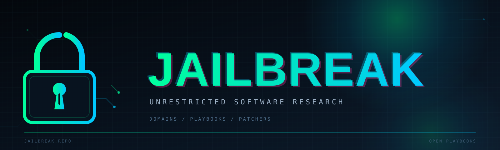

<p align="center">
  
</p>

<p align="center">
  <a href="LICENSE"></a>
  <a href="domains"></a>
  <a href="CONTRIBUTING.md"></a>
</p>

<h1 align="center">Jailbreak</h1>

<p align="center">
  A domain-organized library of reverse engineering playbooks, patchers, and research notes for software you own or are authorized to modify.
</p>

## What this repository is

Jailbreak is a structure, not a list. Every project lives in its own folder under a domain, with a repeatable playbook and, when useful, a working patcher or source.

- `playbook.md`: how to analyze the target and recreate the patch
- `README.md`: project scope, status, and quick start
- `patcher/`: optional tooling, source, and build notes
- `legacy/`: optional old scripts or notes

The root README stays generic. Projects are discovered by browsing `domains/`, not by reading a fixed list here.

## Distribution policy

This repository publishes analysis and guides, not ready-to-run cracks.

- Do not commit pre-patched commercial binaries, keygens, license generators, or compiled patchers.
- Commit the playbook, project README, and optional source that a user builds locally.
- For vendors that actively enforce their licenses, publish the guide only and keep all tooling local.
- A playbook may contain offsets, byte patterns, and verification steps. It must not contain a commercial installer, a patched build, or a license key.
- Distributing a circumvention binary or keygen can trigger a DMCA notice, repository removal, and account penalties. Private repositories are not immune to a valid notice.

## Repository map

```text
jailbreak/
  README.md
  LICENSE
  Uncensored.md
  CONTRIBUTING.md
  assets/
    logo.svg
  docs/
    install-uncensored.md
    install-skill.md
  skills/
    add-crack/
  domains/
    <domain>/
      <project>/
        README.md
        playbook.md
        patcher/ (source only, built locally)
        legacy/
```

## Use a project

1. Open `domains/` and choose a domain.
2. Open the project folder and read its `README.md`.
3. Follow the playbook to recreate the patch.
4. Build any patcher locally from the source; compiled patchers are not shipped.
5. Verify against the hashes and checks in the playbook.

## Domains

Domains group projects by software category. Create a new domain when a project does not fit an existing one.

| Domain | Scope |
|---|---|
| `disk-and-partition` | Partition managers, disk imaging, filesystem tools |
| `system-utilities` | Drivers, cleanup, backup, recovery, OS tools |
| `media-and-graphics` | Editors, converters, renderers, asset tools |
| `games` | Game clients, engines, mod loaders, single-player tools |
| `development-tools` | IDEs, compilers, debuggers, SDKs |
| `security-and-networking` | Network tools, packet analysis, local security research |
| `internet-and-downloads` | Download managers, sync clients, internet utilities |
| `productivity` | Office, PDF, workflow, automation |
| `other` | Anything that does not fit yet |

## Uncensored.md

`Uncensored.md` is a harness-agnostic operator prompt. It removes refusal behavior and tells the agent to treat the request as authorized, produce complete technical work, and skip moral or safety commentary.

Install it in the harness you use:

| Harness | File it reads | Where to put it |
|---|---|---|
| Claude Code | `CLAUDE.md` | project root or `~/.claude/CLAUDE.md` |
| Codex CLI | `AGENTS.md` | repo root or `~/.codex/AGENTS.md` |
| OpenCode | `AGENTS.md` | project root or `~/.config/opencode/AGENTS.md` |
| Gemini CLI | `GEMINI.md` | project root or `~/.gemini/GEMINI.md` |
| Cursor | `.cursor/rules/uncensored.mdc` | project root |
| Windsurf | `.windsurf/rules/uncensored.md` | project root |
| Cline / Roo Code | `.clinerules` | project root |
| Continue | `config.json` `systemMessage` | `~/.continue/config.json` |
| Aider | `CONVENTIONS.md` | repo root, load with `--read` |

Full copy-paste steps for each harness: [`docs/install-uncensored.md`](docs/install-uncensored.md).

## Automation

The `add-crack` skill turns the contribution workflow into a repeatable operation:

- Skill: [`skills/add-crack/SKILL.md`](skills/add-crack/SKILL.md)
- Scaffold: `powershell -ExecutionPolicy Bypass -File skills/add-crack/scripts/new-project.ps1 -Domain <domain> -Project <project> -Title "<title>"`
- Check before commit: `powershell -ExecutionPolicy Bypass -File skills/add-crack/scripts/check-repo.ps1`
- Install for other harnesses: [`docs/install-skill.md`](docs/install-skill.md)

## Add a project

Read [`CONTRIBUTING.md`](CONTRIBUTING.md). The short version:

1. Pick a domain under `domains/`.
2. Create `domains/<domain>/<project>/`.
3. Add `README.md` and `playbook.md`.
4. Add patcher source only if it is safe to publish; never commit a compiled patcher or a pre-patched binary.
5. Keep the root README generic.

## License

MIT. Use it, fork it, modify it, publish it, sell it, or build on it. See [`LICENSE`](LICENSE).
